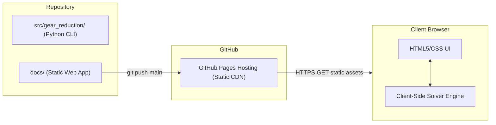

# Client-Side Web Architecture & GitHub Pages Research

**Date**: 2026-11-10  
**Status**: Research & Architectural Analysis  
**Project**: Gear Reduction Solver  
**Reference Document**: [`.proposal`](file:///home/beattidp/Documents/antigravity/gear-reduction-solver/.proposal)

---

## 1. Objectives & Constraints

The user requirement specifies:
> *"For a Web-based solution, it should be entirely client-side and not require anything of the server but to deliver the app. Please research what it will take to run from a GitHub-hosted web site, as well as locally."*

### Key Requirements
1. **Server Independence**: The server only acts as a static file server (no Python backend, no Flask/FastAPI/Django, no database).
2. **GitHub Pages Compatibility**: Must deploy seamlessly to GitHub Pages (which only serves static HTML, CSS, JS, WASM, and assets).
3. **Local Execution**: Must be trivial to run locally without complex setup (e.g., standard `python -m http.server`, `npx serve`, or offline PWA).
4. **Interactivity**: Must support interactive inputs, an 11T–40T gear tooth toggle dialog/grid, real-time solving, and structured tabular results.

---

## 2. Technical Architectural Options

### Approach A: Pyodide / WebAssembly (Single-Codebase Python)

**Overview**: Run the exact Python core solver codebase in the user's browser using [Pyodide](https://pyodide.org/) (CPython compiled to WebAssembly).

```
   GitHub Pages / Local Static Server
      │  (serves static HTML/JS/CSS + python package)
      ▼
   User Browser
   ┌────────────────────────────────────────────────────────┐
   │ Main UI Thread                                         │
   │  • HTML5 Input Form ([in:out], Worm toggle, Max sol)   │
   │  • 11T-40T Tooth Selection Matrix                      │
   │  • Interactive Results Table & SVG Gear Diagram        │
   │                             │ PostMessage              │
   │                             ▼                          │
   │ Web Worker (Background Thread)                         │
   │  • Pyodide Runtime (WebAssembly CPython 3.12)          │
   │  • src/gear_reduction/core/solver.py                   │
   │  • Computes solutions without blocking UI              │
   └────────────────────────────────────────────────────────┘
```

#### How it Works:
1. **Deployment on GitHub Pages**:
   - Web assets placed in `web/` (or `docs/`).
   - `index.html` loads Pyodide from CDN (`https://cdn.jsdelivr.net/pyodide/v0.26.4/full/pyodide.js`) or local vendor directory.
   - The Python solver module is bundled as a pure-Python wheel (`gear_reduction-0.1.0-py3-none-any.whl`) or fetched as raw `.py` files.
   - When the user clicks "Solve", JavaScript calls the Python solver via Pyodide's Web Worker and receives structured JSON results.
2. **Local Execution**:
   - Run in terminal: `python -m http.server 8000 --directory web`
   - Open browser at `http://localhost:8000`.
3. **Pros**:
   - **100% DRY (Single Source of Truth)**: The exact same Python files used for the CLI run in the web app. Any algorithm improvement or bug fix in Python immediately updates both CLI and Web.
   - Python unit tests (`pytest`) guarantee correctness across both CLI and Web.
4. **Cons**:
   - Initial load download: ~10 MB for the Pyodide WebAssembly engine on first page visit (cached by browser subsequently).

---

### Approach B: Pure Modern Client-Side JavaScript / TypeScript (Vanilla Web SPA)

**Overview**: Implement the solver algorithm in lightweight ES6 JavaScript (or TypeScript compiled to ES modules) alongside the Python CLI solver.

```
   GitHub Pages / Local Static Server
      │  (serves < 50 KB static HTML/CSS/JS)
      ▼
   User Browser
   ┌────────────────────────────────────────────────────────┐
   │ Single-Page Application (SPA)                          │
   │  • Native HTML5 Dialog & CSS Grid (11T-40T buttons)    │
   │  • Client-side JS Solver (Pure Combinatorics & Math)   │
   │  • Instant calculation (< 5ms)                         │
   │  • Progressive Web App (PWA) Offline Service Worker    │
   └────────────────────────────────────────────────────────┘
```

#### How it Works:
1. **Deployment on GitHub Pages**:
   - Entire application consists of static files: `index.html`, `style.css`, `app.js`, and `solver.js`.
   - Total payload is less than 50 KB.
2. **Local Execution**:
   - Run `python -m http.server` or open `index.html` directly in the browser.
3. **Cross-Language Verification**:
   - A shared JSON test fixture (`tests/fixtures/test_cases.json`) is run by both `pytest` (for Python CLI) and a Node/browser test runner (for JS) to guarantee 100% parity between Python and JS solvers.
4. **Pros**:
   - Instantaneous load time (< 100ms).
   - Zero external runtime downloads.
   - Highly responsive, lightweight, mobile-friendly.
   - Can install as an offline Progressive Web App (PWA) with desktop icon.
5. **Cons**:
   - Maintaining two implementations of the solver logic (Python for CLI, JS/TS for Web).

---

## 3. Comparison & Recommendation

| Feature | Approach A: Pyodide (WASM Python) | Approach B: Pure JS / TS SPA |
| :--- | :--- | :--- |
| **Codebase** | **Single Codebase (Python only)** | Dual (Python CLI + JS Web) |
| **Initial Download** | ~10 MB (Pyodide runtime) | **< 50 KB (Instant)** |
| **Startup Speed** | ~1.5s cold start (cached thereafter) | **< 0.1s instant** |
| **GitHub Pages Hosting** | 100% compatible (static files) | 100% compatible (static files) |
| **Local Running** | `python -m http.server` | `python -m http.server` or direct |
| **Offline Support** | Yes (via Service Worker) | Yes (via Service Worker / PWA) |
| **Maintenance** | Single algorithm file to maintain | Shared JSON test fixture verifies both |

### Recommended Path:
1. **Phase 1: Build the Python Core Domain Solver & CLI first** (as approved).
   - Solidify the data structures, exact rational solver, approximate search, cost calculations, and comprehensive `pytest` suite.
   - Output structured JSON test cases (`tests/fixtures/test_cases.json`).
2. **Phase 2: Deliver Client-Side Web Application**:
   - Because the solver algorithm is concise (~150 lines), **Approach B (Pure JS/ESM)** provides the ultimate user experience: instant load, ultra-small size, and works anywhere on GitHub Pages or locally with zero setup.
   - Alternatively, **Approach A (Pyodide)** can be used if strict single-language maintenance is preferred.
   - We will support static hosting from the repository's `docs/` folder or via GitHub Actions `actions/deploy-pages`.

---

## 4. GitHub Pages Deployment Architecture



### Static Hosting Configuration:
* Deploy directory: `docs/` on branch `main` (or GitHub Actions static pages).
* Local testing:
  ```bash
  python3 -m http.server 8000 --directory docs
  ```
* No build toolchain strictly required if using standard ES modules; or Vite can be used if bundling/minifying is desired.
